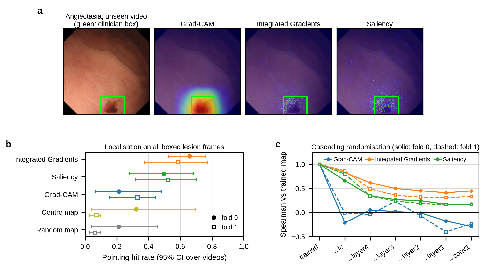
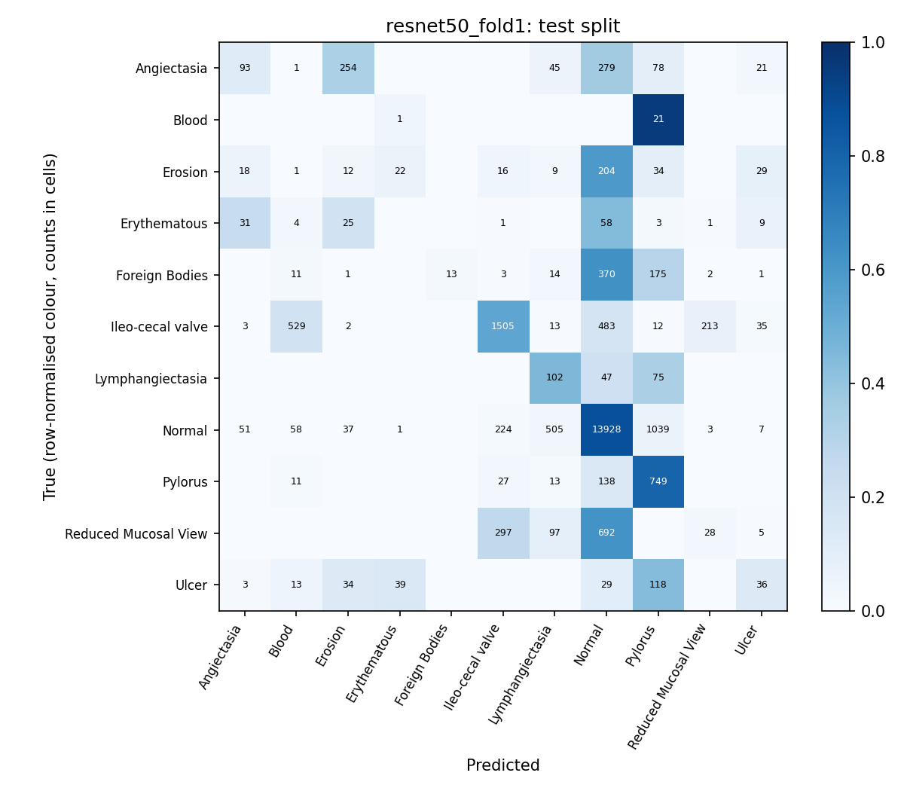
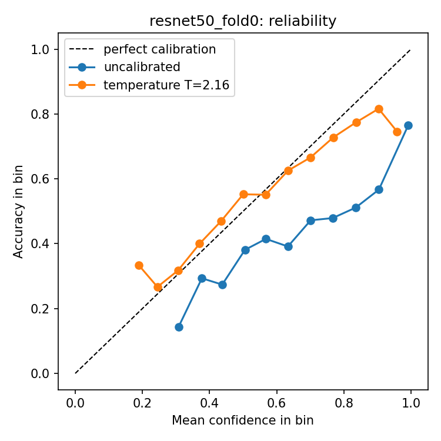
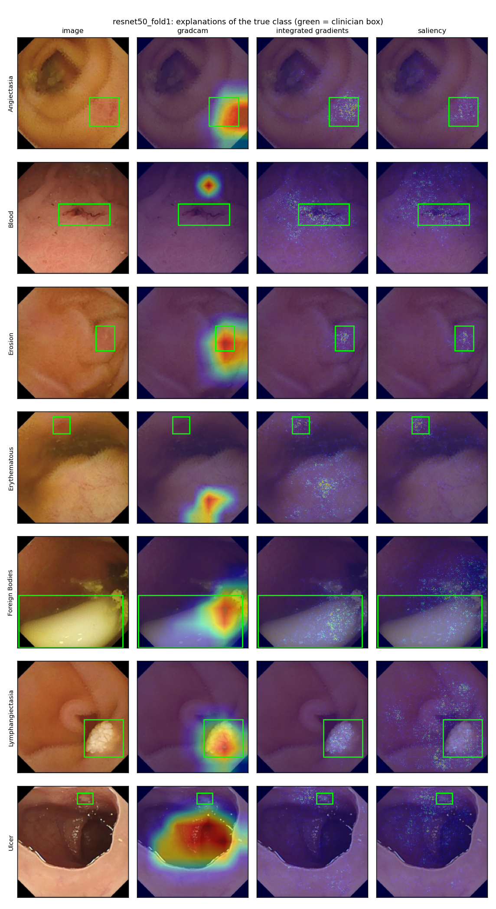
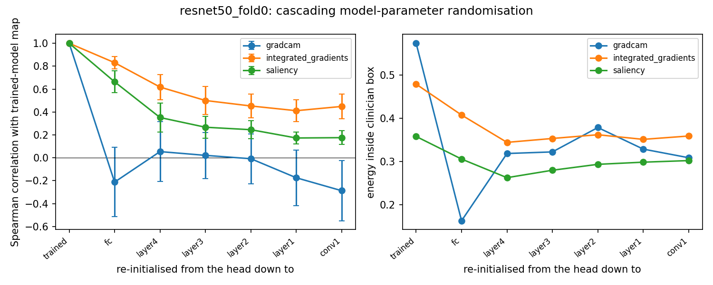

# Do saliency maps find the lesion? Explainable AI on Kvasir-Capsule

This project fine-tunes an ImageNet CNN to classify video capsule endoscopy frames and
then tests the explanations it produces. It asks three questions:

1. **Localisation.** Do Grad-CAM, Integrated Gradients and Saliency maps put their weight
   inside the clinician's bounding box, and by how much more than a map that knows nothing
   about the image?
2. **Faithfulness.** Do the maps depend on what the model learned? This is checked with
   the cascading model-parameter randomisation test of Adebayo et al. (2018).
3. **Calibration.** Can the classifier's confidence be trusted, before and after
   temperature scaling?

Every number is reported with a 95% confidence interval from a bootstrap over videos,
because frames from one video are strongly correlated.

> **Main finding.** On boxed lesion frames, Integrated Gradients and Saliency hit the
> clinician's box far more often than chance in both folds. Grad-CAM localises worse,
> at chance level in one fold. The sanity check reverses this ranking. Grad-CAM
> depends on the trained weights, while Integrated Gradients maps stay strongly
> correlated with the trained-model maps after the classifier head is randomised
> (Spearman 0.83–0.87). They still find the box in 34–57% of frames after every layer is
> re-initialised. The method that localises best is the one that depends least on what
> the model learned, so good localisation alone is not evidence of a faithful explanation.
> Results are from ResNet-50 on both directions of the official 2-fold protocol (one seed each).



*(a) Explanations for a correctly classified angiectasia frame from a video not seen in training,
chosen by a fixed rule that does not use any explanation score (`scripts/summary_figure.py`).
(b) Pointing hit rate on all boxed lesion frames. (c) Cascading randomisation.*

## Dataset and protocol

[Kvasir-Capsule](https://datasets.simula.no/kvasir-capsule/) (Smedsrud et al., 2021) has
47,238 labelled frames in 14 classes. This project uses the authors'
[official two-fold splits](https://github.com/simula/kvasir-capsule/tree/master/official_splits),
which leave out Polyp, Blood - hematin and Ampulla of Vater. That leaves **47,161 frames
in 11 classes from 43 videos**, all 336×336 px. The model is trained on one split and tested on the other,
in both directions, and the two results are averaged.

`scripts/prepare_data.py` checks every download against a pinned SHA-256 and writes
`results/data_audit.json`. The audit found:

| Class | Split 0 | Split 1 | Frames with a box (0 / 1) |
|---|---:|---:|---:|
| Angiectasia | 771 | 95 | 771 / 95 |
| Blood | 22 | 424 | 22 / 424 |
| Erosion | 345 | 161 | 345 / 161 |
| Erythematous | 132 | 27 | 90 / 27 |
| Foreign Bodies | 590 | 186 | 590 / 186 |
| Ileo-cecal valve | 2,795 | 1,394 | – |
| Lymphangiectasia | 224 | 368 | 224 / 368 |
| Normal | 15,853 | 18,485 | – |
| Pylorus | 938 | 591 | – |
| Reduced Mucosal View | 1,119 | 1,787 | – |
| Ulcer | 272 | 582 | 272 / 582 |
| **Total** | **23,061** | **24,100** | 2,314 / 1,843 |

Points to keep in mind when reading the results:

- **Class imbalance.** 72.8% of frames are Normal. Accuracy is therefore a weak measure.
  The model is selected on validation MCC, and macro-F1, balanced accuracy and MCC are
  reported alongside accuracy.
- **Videos shared between the splits.** The dataset paper states that no video is shared
  between splits, but the published split files share 7 of the 43 videos (checked from the
  filename prefixes in `split_0.csv` and `split_1.csv`). These 7 videos contribute frames to both splits, each time with different classes in the two splits
  (5,052 frames in split 0, 2,892 in split 1). A model can therefore be tested on a patient it
  saw in training. Results are reported on the official test split (`subset=all`) and again
  on the test frames from the remaining videos only (`subset=unseen_videos`).
- **Very small classes.** Blood has 22 frames in split 0, and Erythematous has 27 in split 1,
  all from a single video that is also in split 0. Per-class scores for these are not
  reliable, and Erythematous is absent from the `unseen_videos` subset of split 1.
- **Two findings on one frame.** 16 rows of the index (8 frames) carry two findings. They are
  kept, as in the official splits, and flagged with `multi_finding=1`.
- **Boxes.** Metadata gives each box as four corner points. The axis-aligned box around
  them is used. Boxes are rectangles around the finding, not pixel masks.

## Method

**Classifier.** ResNet-50 pretrained on ImageNet (ResNet-18 and DenseNet-121 are also
supported), input 224×224, with flips, 90° rotations and light colour jitter.
AdamW (lr 1e-4, weight decay 1e-4) with a one-cycle schedule, 10 epochs, batch 64 and
mixed precision on GPU. The loss is cross-entropy with inverse-square-root class weights.
Validation is one of five video-grouped, class-stratified folds of the training split, so no
video is shared between training and validation. The checkpoint with the best validation MCC
is kept.

**Explanations** ([Captum](https://captum.ai/)), always for the true class:

| Method | Notes |
|---|---|
| Grad-CAM (Selvaraju et al., 2017) | last convolutional block, upsampled bilinearly |
| Integrated Gradients (Sundararajan et al., 2017) | black-image baseline, 32 steps, \|attribution\| summed over channels |
| Saliency (Simonyan et al., 2014) | \|gradient\| summed over channels |
| `random` | uniform noise: the chance level |
| `center` | Gaussian centred on the image: lesions are not uniformly placed, so a fixed centre prior can score above chance |

A method is only useful if it clearly beats both reference maps.

**Localisation metrics**, computed for each boxed lesion frame of the test split:

| Metric | Definition | Chance level |
|---|---|---|
| `pointing_hit` | the most important pixel lies inside the box (pointing game, Zhang et al., 2018) | box area fraction |
| `energy_in_box` | share of positive attribution mass inside the box (Wang et al., 2020) | box area fraction |
| `top_area_prec` | of the *k* most important pixels, *k* = box area, the share inside the box | box area fraction |

Results are given for all boxed frames, for correctly classified frames only, and for
frames from unseen videos, overall and by class. `degenerate_rate` is the share of maps with
no positive mass, such as an all-zero Grad-CAM.

**Sanity check.** Layers are re-initialised from the classifier head downwards
(fc, layer4, …, conv1). After each step, the maps of 100 test frames are compared with the
trained model's maps by Spearman rank correlation, on 4×4-pooled absolute maps. If the
correlation stays high while the model is being destroyed, the method shows image structure
rather than what the model learned.

**Calibration.** ECE and MCE (15 bins), NLL and Brier score, before and after temperature
scaling (Guo et al., 2017), with the temperature fitted on validation logits.

## Results

ResNet-50, 10 epochs on a Colab T4 GPU (about 22 minutes per fold). **Fold 0** trains on
split 0 and tests on split 1, and **fold 1** the reverse. Square brackets are 95% confidence
intervals from a bootstrap over test videos.

### Classification

| | Fold 0 | Fold 1 | Mean |
|---|---:|---:|---:|
| Accuracy | 0.695 | 0.714 | 0.705 |
| Always predicting Normal | 0.767 | 0.687 | 0.727 |
| Balanced accuracy | 0.268 | 0.273 | 0.271 |
| Macro-F1 | 0.198 [0.156, 0.323] | 0.239 [0.195, 0.329] | 0.219 |
| MCC | 0.357 [0.266, 0.454] | 0.432 [0.295, 0.580] | 0.395 |
| MCC, unseen videos only | 0.374 [0.274, 0.494] | 0.478 [0.300, 0.641] | 0.426 |

For comparison, the dataset paper reports a mean macro-F1 of 0.233–0.256 and MCC of
0.378–0.433 across its six DenseNet-161 and ResNet-152 configurations on the same splits
(Smedsrud et al., 2021, Table 3). This model is therefore a typical baseline, slightly below the published ones.
The classifier is weak where it matters most:

- **Lesion frames are mostly missed.** Only 136 of 1,843 (7.4%) boxed lesion frames are
  classified correctly in fold 0, and 255 of 2,314 (11.0%) in fold 1. They are mostly
  predicted as Normal, Ileo-cecal valve, Pylorus or Erosion (`results/per_class_*.csv`).
- **Overfitting.** Training loss falls below 0.01, and validation MCC peaks at epoch 9 in
  fold 0 (0.461) but at epoch 3 in fold 1 (0.237) (`runs/*/history.csv`).
- **The shared videos do not inflate the scores.** Scores on test frames from unseen videos
  are the same or slightly higher. The shared videos contribute different classes to
  each split, so the model saw the patient but not the finding.



### Calibration

The model is overconfident: mean confidence is 0.93 and 0.89, against accuracy of 0.70
and 0.71. Temperature scaling fitted on validation logits cuts ECE by about two thirds.

| | Fold 0 | Fold 1 |
|---|---:|---:|
| Temperature | 2.16 | 1.76 |
| ECE, before → after | 0.235 → 0.083 | 0.177 → 0.055 |
| NLL, before → after | 2.03 → 1.21 | 1.44 → 1.09 |
| Brier, before → after | 0.535 → 0.482 | 0.475 → 0.445 |



### Localisation: do the maps point at the lesion?

`pointing_hit` on all boxed lesion frames of the test split. The chance level is the mean
box area: 0.208 in fold 0 (larger boxes, 1,843 frames, 10 videos) and 0.064 in fold 1
(2,314 frames, 12 videos).

| Method | Fold 0 | Fold 1 | Fold 0, correct only (n=136) | Fold 1, correct only (n=255) |
|---|---:|---:|---:|---:|
| `random` | 0.213 [0.039, 0.456] | 0.063 [0.031, 0.099] | 0.301 | 0.067 |
| `center` | 0.322 [0.038, 0.697] | 0.072 [0.031, 0.100] | 0.618 | 0.157 |
| Grad-CAM | 0.214 [0.065, 0.479] | 0.330 [0.152, 0.442] | 0.721 | 0.608 |
| Integrated Gradients | **0.659** [0.523, 0.759] | **0.586** [0.374, 0.771] | **0.787** | **0.835** |
| Saliency | 0.495 [0.282, 0.681] | 0.522 [0.320, 0.701] | 0.544 | 0.553 |

- **Integrated Gradients and Saliency** beat both reference maps in both folds, and the
  intervals for Integrated Gradients lie above the random map in both.
- **Grad-CAM** is at chance level over all frames in fold 0, and below chance on frames from
  unseen videos (0.100 against 0.229 for `random`). It localises well when the
  prediction is correct (0.72 and 0.61), which fits a map of the evidence for the class.
  When the model has not recognised the lesion, there is little evidence to show.
- **Energy inside the box** gains less. Integrated Gradients puts 29% and 19% of its mass
  inside the box, against chance levels of 21% and 6%. Pixel-level maps are noisy, so they
  can win the single-pixel pointing game while spreading most of their mass outside the box.
- **Intervals are wide.** Only 10–12 test videos contain boxed lesions. Per-class results
  are in `results/localisation_by_class_*.csv`.



### Sanity check: do the maps depend on the model?

100 correctly classified boxed frames per fold. The table gives Spearman correlation with
the trained-model map (1 = unchanged), and the pointing hit rate in brackets.

| Method | Trained | Head (`fc`) randomised | All layers randomised |
|---|---|---|---|
| Grad-CAM, fold 0 / 1 | 1 (0.71 / 0.63) | −0.21 / −0.02 | −0.29 / −0.23 (0.02 / 0.00) |
| Integrated Gradients, fold 0 / 1 | 1 (0.78 / 0.80) | **0.83 / 0.87** | 0.45 / 0.34 (**0.57 / 0.34**) |
| Saliency, fold 0 / 1 | 1 (0.52 / 0.48) | 0.66 / 0.80 | 0.18 / 0.17 (0.25 / 0.06) |

- **Grad-CAM passes.** Its maps become unrelated to the trained maps as soon as the
  classifier head is randomised, and stop finding the lesion.
- **Integrated Gradients largely fails.** Its maps barely change when the head is
  randomised. With every layer re-initialised, it still points inside the box in 57% (fold 0)
  and 34% (fold 1) of frames. Much of its localisation therefore comes from the image itself,
  for example bright or red lesions standing out from the mucosa, rather than from what the
  model learned. This agrees with Adebayo et al. (2018).
- **Saliency** sits in between.



All numbers: `results/classification.csv`, `results/calibration.csv`,
`results/localisation_*.csv`, `results/sanity_*.csv`. Figures for both folds are in `figures/`.

## How to run

### Colab (recommended, needs a GPU)

[](https://colab.research.google.com/github/palniraj/xai-capsule-endoscopy/blob/main/notebooks/colab_pipeline.ipynb)

Open `notebooks/colab_pipeline.ipynb` in Colab with a T4 GPU and run all cells. Checkpoints
go to Google Drive, so a disconnect only loses the current epoch.

### Local

```bash
python -m venv .venv && source .venv/bin/activate
pip install torch torchvision --index-url https://download.pytorch.org/whl/cpu   # or a CUDA build
pip install -r requirements.txt

python scripts/prepare_data.py                         # ~520 MB download, builds data/index.csv
python scripts/train.py --arch resnet50 --train-fold 0  # train on split 0, test on split 1
python scripts/train.py --arch resnet50 --train-fold 1
python scripts/evaluate.py runs/resnet50_fold0 runs/resnet50_fold1
python scripts/explain_eval.py --run runs/resnet50_fold0
python scripts/sanity_check.py --run runs/resnet50_fold0 --n-images 100
python scripts/summary_figure.py --run runs/resnet50_fold1 --runs runs/resnet50_fold0 runs/resnet50_fold1
```

CPU smoke test (a few minutes, numbers are meaningless):

```bash
python scripts/train.py --arch resnet18 --train-fold 0 --no-pretrained --epochs 2 \
    --max-images 96 --out runs/smoke_resnet18_fold0
python scripts/evaluate.py runs/smoke_resnet18_fold0
python scripts/explain_eval.py --run runs/smoke_resnet18_fold0 --max-images 30 --ig-steps 8
python scripts/sanity_check.py --run runs/smoke_resnet18_fold0 --n-images 4 --ig-steps 8
```

## Repository layout

```
capxai/            config (paths, URLs, SHA-256, classes), data, models, metrics, explain
scripts/           prepare_data, train, evaluate, explain_eval, sanity_check, summary_figure
notebooks/         colab_pipeline.ipynb
results/           metric tables (CSV) and data_audit.json
figures/           confusion, reliability, explanation and sanity-check figures
data/, runs/       dataset and checkpoints (created by the scripts, not committed)
```

## Limitations

- One dataset and one capsule model. Nothing here says how the classifier or its
  explanations behave on other capsules or hospitals.
- Bounding boxes are coarse, so a map can be right about the lesion and still lose mass
  outside a tight box, or score well on a large box by chance. The chance level
  (`box_area_frac`) is reported next to every score for that reason.
- Maps explain the true class. For misclassified frames this is not what the model "used"
  for its prediction, which is why the correctly classified subset is reported separately.
- A single training seed per fold. The fold-to-fold difference is the only estimate of
  training variance, and fold 1 selected an early epoch (3) with low validation MCC.
- The classifier recognises few lesion frames, so the correctly classified subsets are small
  (136 and 255 frames).
- The sanity check uses 100 frames per run, drawn from the correctly classified boxed frames.
- Only ResNet-50 has been run. DenseNet-121 and ResNet-18 are supported but untested at full scale.

## References

- Smedsrud, P. H. et al. (2021). Kvasir-Capsule, a video capsule endoscopy dataset. *Scientific Data* 8, 142.
- Adebayo, J. et al. (2018). Sanity checks for saliency maps. *NeurIPS*.
- Guo, C. et al. (2017). On calibration of modern neural networks. *ICML*.
- Selvaraju, R. R. et al. (2017). Grad-CAM: Visual explanations from deep networks via gradient-based localization. *ICCV*.
- Simonyan, K., Vedaldi, A. & Zisserman, A. (2014). Deep inside convolutional networks: Visualising image classification models and saliency maps. *ICLR Workshop*.
- Sundararajan, M., Taly, A. & Yan, Q. (2017). Axiomatic attribution for deep networks. *ICML*.
- Wang, H. et al. (2020). Score-CAM: Score-weighted visual explanations for convolutional neural networks. *CVPR Workshops*.
- Zhang, J. et al. (2018). Top-down neural attention by excitation backprop. *IJCV* 126, 1084–1102.
- Kokhlikyan, N. et al. (2020). Captum: A unified and generic model interpretability library for PyTorch. *arXiv:2009.07896*.

## Licence

The code is released under the MIT licence (see `LICENSE`). The Kvasir-Capsule data is
distributed by its authors under CC BY 4.0 and is not redistributed in this repository.
